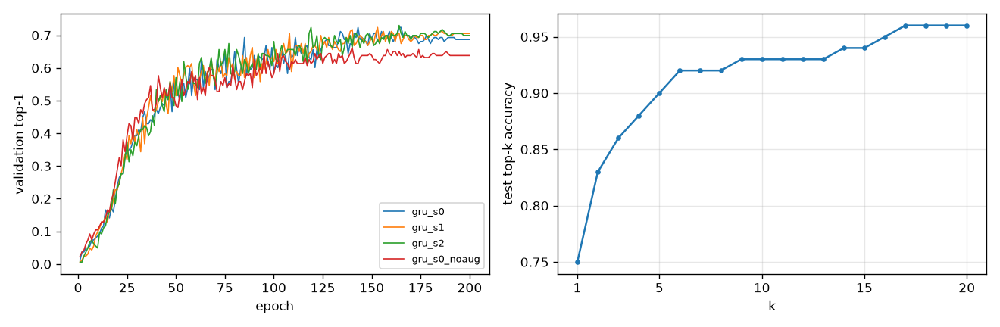
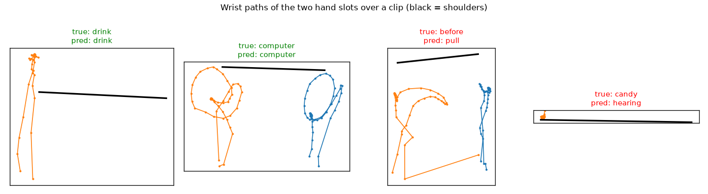

# Real-time Sign Language Recognition (MediaPipe + GRU, WLASL100)

Recognises 100 American Sign Language words from a webcam. MediaPipe turns each video frame
into hand and upper-body landmarks; a small bidirectional GRU reads the sequence of
landmarks and names the word; a live demo shows the prediction on screen.

New to this? Start with **[LESSON.md](LESSON.md)**: concepts first, then a code walkthrough.

## Results

Chance is 1% (100 words). Headline numbers average three training seeds, a choice made
before looking at the test set. 95% confidence intervals are Wilson intervals; with about
100 test clips, every accuracy here is uncertain by roughly ±9 points.

| evaluation | test clips | top-1 | top-5 | top-10 |
|---|---:|---:|---:|---:|
| WLASL's **official split** | 100 (72 words) | **75%** (95% CI 66–83%) | 90% | 93% |
| **Unseen signers** (whole people held out) | 92 (16 people, 61 words) | **67%** (95% CI 57–76%) | 84% | 90% |

**Why two evaluations?** WLASL's official split is by clip, not by person: 97 of the 100
surviving test clips are by signers who also appear in training. That flatters the model,
because it can partly recognise *how that person* signs. For the second row, whole signers
(about 20% of clips) were held out of both training and validation. It's the better
estimate of how the live demo works for a stranger: 67% top-1 and 84% top-5.

For context, the WLASL paper reports 55% top-1 for its pose-based model (Pose-TGCN) and 66%
for a video model (I3D) on WLASL100. **Our numbers aren't directly comparable**: about half
of WLASL's videos are now dead links, so we train and test on the 1,007 clips that survive
(the full test set had 258 clips; 100 survive), which may be easier ones.

| ablation (official split, single seed) | val top-1 | test top-1 |
|---|---:|---:|
| GRU with augmentation (seed 0) | 72% | 70% |
| GRU without augmentation | 66% | 68% |

Seeds 0–2 on the official split: 70%, 74%, 75% top-1; on unseen signers: 63%, 63%, 71%. Augmentation helps by a few points;
with 100 test clips the test difference (2 points) is within noise.



## What it gets wrong



- **Signs made at the face.** "Candy" was read as "hearing": both are index-finger signs at
  the cheek or mouth, and from the face we keep only the nose landmark. Signs that differ by
  *where on the face* they're made are a blind spot. Adding face landmarks is the next step.
- **Signs with similar paths.** "Before" → "pull", "walk" → "dance", "like" → "same": similar
  two-handed movements in front of the body.
- **Fine finger shapes.** The model sees 21 points per hand, but with 7 training clips per word
  it mostly learns paths, not handshapes. Every error was a different pair (no pair occurs
  twice), so there is no single systematic confusion.

## Live webcam demo

```bash
uv run python scripts/live_demo.py        # macOS asks for camera access the first time
```

Start with your hands down, raise them, sign **one** word, lower them. While your hands are
visible, frames are collected; when they've been down for ~0.3 s, the word appears at the
top with the next two guesses. Press `q` to quit. If the camera won't open: System Settings →
Privacy & Security → Camera, and allow your terminal app.

**What was verified:** the same pipeline (`--video clip.mp4 --headless`) was run on 8 test
clips and found exactly one sign segment in each; 6 of 8 were correct (drink, computer,
before, go, clothes, who; two clips of "before" were wrong). **Not verified here:** a live
camera session, which needs you in front of the camera. Expect lower accuracy than the table:
webcam lighting, distance and signing speed differ from the dictionary videos, and you're a
new signer.

## How it works

1. **Data** (`scripts/download_data.py`): WLASL's index, the first 100 words; the clips that
   still exist come from the [Voxel51/WLASL](https://huggingface.co/datasets/Voxel51/WLASL)
   Hugging Face mirror, pinned to one commit (1,007 clips, 500 MB). Also MediaPipe's models.
2. **Landmarks** (`scripts/extract_landmarks.py`, `src/sign/landmarks.py`): MediaPipe
   HandLandmarker + PoseLandmarker on every frame → 7 body + 2×21 hand points, normalised to
   the shoulders (origin = shoulder midpoint, unit = shoulder width). Cached once (13 MB);
   training never touches video again.
3. **Model** (`src/sign/model.py`): trim to the frames where hands are visible, resample to 32
   frames, add velocities, per-frame MLP, 2-layer bidirectional GRU, mean+max pooling, 100-way
   classifier. 0.63 M parameters.
4. **Training** (`scripts/train.py`): heavy augmentation (temporal crop, rotation, scale,
   shift, mirror for left-handed signing), label smoothing, AdamW, one-cycle schedule, 200
   epochs; keep the best validation epoch. About 16 min per run on an M1 CPU.
5. **Evaluation** (`scripts/evaluate.py`) and the **demo** (`scripts/live_demo.py`) use the
   same trimming and resampling code as training.

## Honest notes

- **Half the dataset is gone.** 1,007 of WLASL100's 2,038 clips survive (744 train, 163 val,
  100 test); 6 more are listed in the mirror but return 404.
- **Small test sets.** 100 and 92 clips; only 61 of the 100 words appear in the
  unseen-signer test. Confidence intervals are reported for that reason.
- **The unseen-signer split was fixed in advance**: a seeded shuffle of signer IDs, applied
  once. Its validation set is 4 signers (one of them prolific), so model selection there is
  noisy.
- **One training run crashed** (an interrupted system call while saving a checkpoint, under
  heavy CPU load) and was rerun; the numbers above use the complete rerun.
- **Isolated words only.** Real signing is continuous, uses facial grammar and space, and is a
  language, not a list of gestures. This is a word-recognition demo, not translation.

## Reproduce

Needs [uv](https://docs.astral.sh/uv/) and Python 3.12. CPU is enough. About 520 MB of data.

```bash
git clone https://github.com/Nipuna-Lakruwan/wlasl100-sign-recognition.git
cd wlasl100-sign-recognition && uv sync
uv run python scripts/download_data.py      # ~500 MB; re-run if connections drop
uv run python scripts/extract_landmarks.py  # ~15 min with 3 processes
for s in 0 1 2; do uv run python scripts/train.py --seed $s; done
for s in 0 1 2; do uv run python scripts/train.py --seed $s --split signer; done
uv run python scripts/train.py --seed 0 --no-aug
uv run python scripts/evaluate.py
uv run python scripts/live_demo.py          # needs gru_s0.pt from the first loop
uv run pytest
```

## Resume bullet

> Built a real-time ASL word recognizer (MediaPipe hand/pose landmarks + bidirectional GRU,
> PyTorch) on WLASL100 with a live webcam demo: 75% top-1 / 90% top-5 on the official test
> split and 67% / 84% on signers never seen in training (100 classes, 1% chance).

## Data and licences

WLASL (Li et al., WACV 2020) is for academic and computational use only, under the
[C-UDA licence](https://github.com/microsoft/Computational-Use-of-Data-Agreement); videos are
not redistributed here. MediaPipe models: Apache 2.0. Code: MIT.
